<a href="https://github.com/orangejustin">
  <picture>
    <source media="(prefers-reduced-motion: reduce) and (max-width: 600px)" srcset="./assets/profile-compact-static.svg">
    <source media="(prefers-reduced-motion: reduce)" srcset="./assets/profile-static.svg">
    <source media="(max-width: 600px)" srcset="./assets/profile-compact.svg">
    
  </picture>
</a>

  <a href="https://orangejustin.github.io/">Portfolio ↗</a> &nbsp; · &nbsp;
  <a href="https://www.linkedin.com/in/zecheng-li-664536213/">LinkedIn ↗</a> &nbsp; · &nbsp;
  <a href="mailto:zechengl@alumni.cmu.edu">Say hello ↗</a>

## 🍊 Building ML systems that work in production

I'm **Justin**, a **Machine Learning Engineer in Search at TikTok**. My work connects retrieval and ranking model design with evaluation, online serving, and experimentation.

- **Retrieval & ranking:** Generative retrieval from dataset construction through training, indexing, and serving; integration with multi-stage ranking systems.
- **Model scaling & learning objectives:** Transformer rankers, warm-start strategies for sparse embeddings and dense components, listwise distillation, and calibrated multi-task learning.
- **Production reliability:** Offline-to-online feature consistency, ranking observability, model-launch validation, and online experiments.

Previously, I worked on **Bayesian time-series modeling and multimodal anomaly detection at Argonne National Laboratory**. I'm a **CMU MISM graduate** and **UC San Diego alumnus**.

Away from models: basketball, fitness, cooking, and exploring trails. Still curious, innovative, and motivated :)

---

**Let's connect.** I'm open to collaborating on LLM and Generative AI projects. Find me on [LinkedIn](https://www.linkedin.com/in/zecheng-li-664536213/), explore my [portfolio](https://orangejustin.github.io/), or reach out at [zechengl@alumni.cmu.edu](mailto:zechengl@alumni.cmu.edu).
