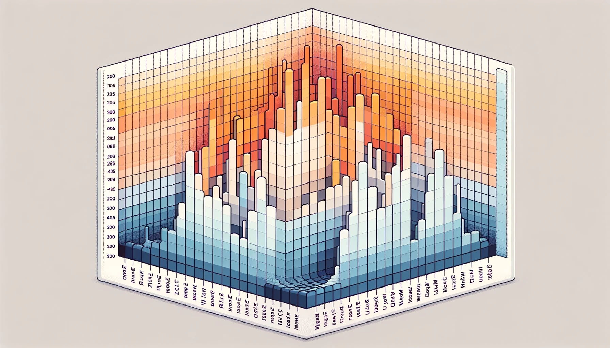

<a href="https://github.com/orangejustin">
  <picture>
    <source media="(max-width: 600px)" srcset="./assets/profile-compact.svg">
    
  </picture>
</a>

  <a href="https://orangejustin.github.io/">Portfolio ↗</a> &nbsp; · &nbsp;
  <a href="https://www.linkedin.com/in/zecheng-li-664536213/">LinkedIn ↗</a> &nbsp; · &nbsp;
  <a href="mailto:zechengl@andrew.cmu.edu">Say hello ↗</a>

## 🍊 Hello, I'm Justin

I'm a curious and passionate grad student from **Carnegie Mellon University**, specializing in **data science and machine learning**. I love transforming complex data into insightful, actionable solutions that create value for businesses and society.

### Exploring & learning

- **Interests:** Data Science, Machine Learning, Analytics
- **Currently learning:** Deep Learning, CUDA, Parallel Distribution, LLMs, Generative AI
- **Let's build together:** I'm open to collaborating on LLM and Generative AI projects.

### My toolkit

| Area | Technologies |
| :-- | :-- |
| **Languages** | Python · Java · R · SQL · JavaScript · CSS · HTML |
| **Frameworks** | PyTorch · TensorFlow · Keras |
| **Tools** | Jupyter · Tableau · Google Cloud · Google Analytics |

### Beyond the screen

Basketball enthusiast, fitness devotee, aspiring chef, and trail explorer—balancing life with the things I love :)

  
A little data-inspired art

   
  

---

**Let's connect.** Find me on [LinkedIn](https://www.linkedin.com/in/zecheng-li-664536213/), explore my [portfolio](https://orangejustin.github.io/), or reach out at [zechengl@andrew.cmu.edu](mailto:zechengl@andrew.cmu.edu).
